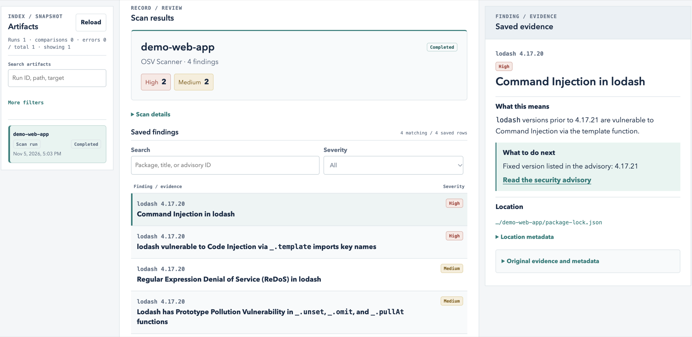
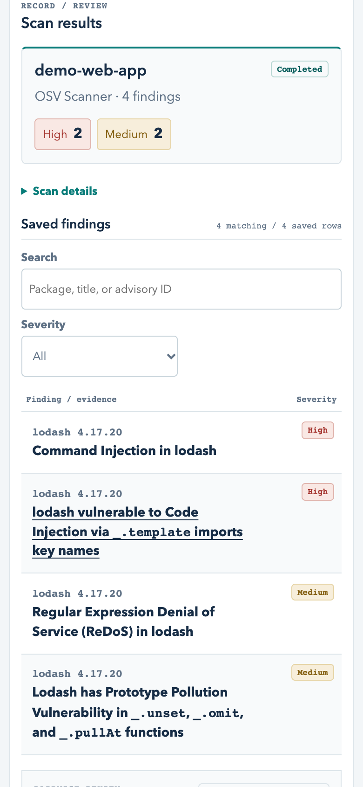
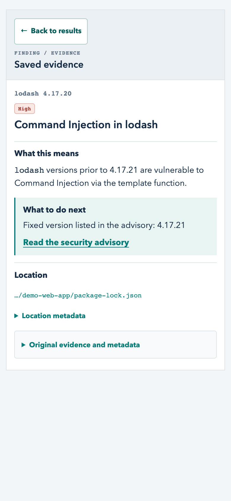

# Sec Hub

Sec Hub Desktop checks the software packages your project relies on for known
security issues. Choose a project folder, run an OSV Scanner check, and see
which packages need attention and why. OSV Scanner is the only scanner in this
desktop release. The Sec Hub CLI can run additional security tools and combine
their results in one report.

## Why it exists

Security scanners often have their own setup, commands, and output formats.
The Sec Hub CLI brings results from multiple security tools together in a
consistent report and shows which checks ran. The desktop app lets you run a
dependency check without opening a terminal.

## Example scan

The updated Developer Workbench is shown here in a macOS development build.
An OSV scan of the demo project's `lodash` 4.17.20 dependency reported four
known vulnerabilities, two high and two medium.

The scan summary shows the project, scanner, status, and counts by severity.
Findings are sorted by severity. Search by package, title, or advisory ID, or
filter by severity. Open a finding to see the affected version, the advisory,
and any fix version recorded in it. Expand **Original evidence and metadata**
to see the raw details.

On narrow screens, findings open in a full-width detail view. **Back to
results** restores the search, filters, scroll position, and keyboard focus.

See the narrow layout

## Download Sec Hub Desktop 0.2.0

This is a **private prerelease**. Sign in to GitHub with an account that has
access to the Sec Hub repository.

| Your computer | Download |
| --- | --- |
| Mac with Apple silicon (M-series) | [Mac ZIP](https://github.com/taejunoh/sec-hub/releases/download/desktop-v0.2.0/sec-hub-desktop-0.2.0-darwin-arm64-notarized-prerelease.zip), signed and notarized |
| Windows x64 (Intel or AMD) | [Windows ZIP](https://github.com/taejunoh/sec-hub/releases/download/desktop-v0.2.0/sec-hub-desktop-0.2.0-win32-x64-prerelease.zip), without a Sec Hub publisher signature. Windows may show an unknown publisher warning. |

This release supports Apple silicon Macs and Windows x64 PCs. Intel Macs
and Windows ARM devices are outside its support range.
[Browse all release assets](https://github.com/taejunoh/sec-hub/releases/tag/desktop-v0.2.0).

## Run your first scan

1. **Extract the ZIP.** On Mac, double-click the ZIP and open **Sec Hub.app**.
   On Windows, right-click the ZIP, choose **Extract All**, then open
   **Sec Hub.exe** from the extracted folder. Keep the Windows app files together.
2. In **Project security scan**, click **Choose folder** and select the project
   folder you want to check. For a first scan, choose the root folder of a
   JavaScript project that contains `package-lock.json`. If the app opens in
   Korean, select **English** at the top of the window.
3. Keep **OSV Scanner** selected and click **Start scan**.
4. When the scan finishes, click **Refresh results & open** to read the report.
   To open it later, choose **File → Show recent scans**.

A completed scan with no findings means OSV Scanner found no known
vulnerabilities in the dependencies it checked. If the scan fails, check the
error message and try again after resolving it.

[See the full setup and scan guide](docs/GETTING-STARTED.md).

## How it works

**Choose a folder → Read the package list → Look up known vulnerabilities →
Save the report**

Electron provides the desktop window. Sec Hub's Node.js code starts the
bundled Google OSV Scanner and saves its results for the app to display. You
can run a scan without installing Node.js or creating an OSV account.

OSV Scanner needs internet access and may send package names and versions to
its advisory and package metadata services. The results cover the supported
dependency files that OSV checked.

## For developers

- [CLI 0.3.2 package](releases/sec-hub-local-0.3.2.tgz) and its
  [technical reference](docs/REFERENCE.md)
- [Sample report from a multi-tool CLI scan](docs/sample-report.html)
- [Desktop build and packaging notes](desktop/README.md)
- [Release and verification history](docs/HISTORY.md)
- [Seven-tool validation record](verification/seven-tools-validation-2026-10-29/REPORT.md)
