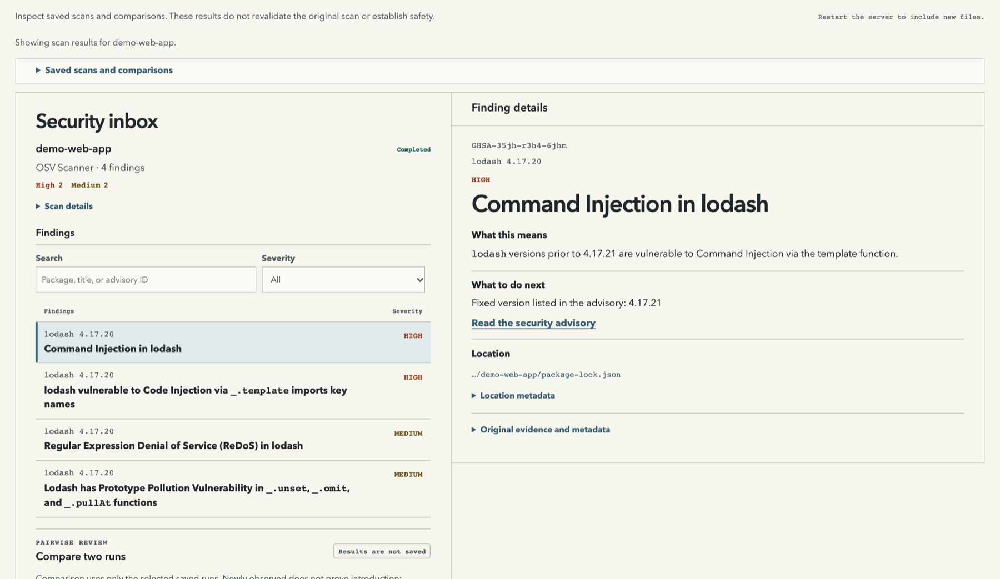
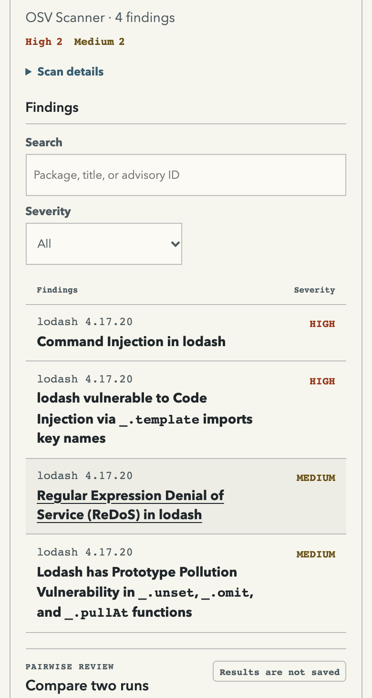
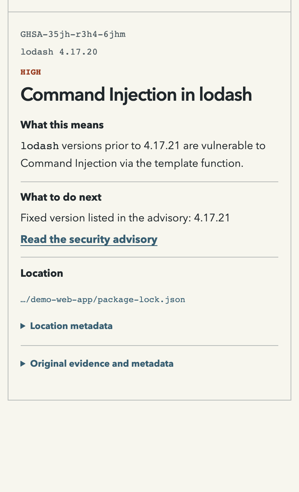

# Security Scan Hub

**Run seven security tools in a single scan. Review the results in one place.**
Security Scan Hub combines dependency checks, AI skill scanning, code review,
and URL checks in one report. See the findings and which tools completed,
were skipped, or failed. Results are available as HTML, JSON, and SARIF.

**Desktop quick start.** Download the [desktop prerelease](https://github.com/taejunoh/security-scan-hub/releases)
and run Google OSV Scanner without a terminal. To run multiple tools,
select them in the app and click **Start scan**. The combined report opens
automatically in the **Security Inbox**. A supported Mac can run all seven
after setup. On Windows, the Cloudflare and Anthropic workflows are disabled.
Follow the [desktop setup guide](desktop/README.md#run-a-multi-tool-scan).

## Seven integrations

| Upstream project | What it checks |
| --- | --- |
| [Google OSV Scanner](https://github.com/google/osv-scanner) | Finds known vulnerabilities in project dependencies. |
| [NVIDIA SkillSpector](https://github.com/NVIDIA/SkillSpector) | Scans AI agent skills for suspicious patterns in static mode. |
| [OpenAI Codex Security](https://github.com/openai/codex-security) | Reviews source code for potential vulnerabilities. |
| [Alibaba Open Code Review](https://github.com/alibaba/open-code-review) | Reviews repository code for security and correctness issues. |
| [OpenAI PHP2Shell Checker](https://github.com/openai/php2shell-checker) | Checks the specified URL's response headers for signs of affected PHP versions. |
| [Cloudflare Security Audit Skill](https://github.com/cloudflare/security-audit-skill) | Runs the upstream audit workflow through the Codex CLI. |
| [Anthropic Defending Code Reference Harness](https://github.com/anthropics/defending-code-reference-harness) | Runs the upstream Claude Code `/vuln-scan` skill in static mode. |

Before installing or upgrading an integration, check the [verified CLI versions](src/adapters/SOURCES.md)
and the [requirements for the Cloudflare and Anthropic workflows](docs/REFERENCE.md#official-security-skill-workflows).
New upstream versions may change sign-in, command options, or report formats.

Install the upstream tools and adapt the [seven-tool configuration](examples/seven-tools.config.json)
to your environment. AI workflows require explicit `--ai` opt-in and may send
code or context to the configured provider. The PHP check uses the URL you supply.
SkillSpector requires a target with a top-level `SKILL.md`. With the tools
configured, select all seven in one command:

```sh
node bin/sec-hub.mjs scan /path/to/project \
  --tools osv,skillspector,codex-security,open-code-review,php2shell,cloudflare,anthropic \
  --ai --config /path/to/sec-hub.config.json \
  --url http://127.0.0.1:8080 --timeout 1200 --out ./sec-hub-runs
```

See the [CLI setup and technical reference](docs/REFERENCE.md) for tool
requirements and execution limits. The [verification history](docs/HISTORY.md#031-source-and-seven-tool-validation)
describes how results from the seven integrations were checked and combined.

## Example scan



The screenshots show the Security Inbox with results from an OSV scan
in the macOS 0.2.0 development build. The demo project's `lodash` 4.17.20
dependency had four findings, two high and two medium. The 0.2.1 and 0.2.2
prerelease packages include this inbox.

The inbox puts the highest severity findings first. Start with critical and
high findings, and confirm whether candidates affect your project. Search by
package, title, or advisory ID, or filter by severity.

In 0.2.3, open a finding and look under **What to do next** for **Check first**
and **Recommended action**. The guidance uses saved scanner evidence, such
as an advisory's fixed version or code suggested by a tool. For PHP header
warnings, it explains how to verify the installed version and patch status.
When the saved result has no specific fix, it directs you to the evidence to
review. Expand **Original evidence and metadata** for the full record.

On narrow screens, findings open in a full-width detail view. **Back to
results** restores the search, filters, scroll position, and keyboard focus.

<details>
<summary>See the narrow layout</summary>





</details>

## Download Security Scan Hub Desktop 0.2.3

Version 0.2.3 is a prerelease. Select several security tools, start one scan,
and review their findings and run status together in the **Security Inbox**.

### Install on Mac (Apple silicon)

1. Download the Developer ID-signed and notarized package. [Download Mac ZIP](https://github.com/taejunoh/security-scan-hub/releases/download/desktop-v0.2.3/sec-hub-desktop-0.2.3-darwin-arm64-notarized-prerelease.zip)
2. In Finder, double-click the ZIP to extract it.
3. Open **Sec Hub.app**. The app window is titled **Security Scan Hub**.

The Mac package supports M-series Macs and can run all seven integrations
after setup.

### Install on Windows (x64)

1. Download the Windows x64 prerelease for Intel and AMD PCs. [Download Windows ZIP](https://github.com/taejunoh/security-scan-hub/releases/download/desktop-v0.2.3/sec-hub-desktop-0.2.3-win32-x64-prerelease.zip)
2. In File Explorer, right-click the ZIP and choose **Extract All**.
3. Open **Sec Hub.exe** from the extracted folder. Keep the extracted files together.

The Windows package is unsigned, so Windows may show an unknown publisher
warning. Up to five integrations are available after setup. The Cloudflare
and Anthropic workflows are disabled on Windows.

OSV Scanner is bundled on both platforms. Other tools require setup, and AI
tools require provider sign-in and consent. [Browse all release assets](https://github.com/taejunoh/security-scan-hub/releases/tag/desktop-v0.2.3)
· [Verify ZIP checksums](https://github.com/taejunoh/security-scan-hub/releases/download/desktop-v0.2.3/sec-hub-desktop-0.2.3-SHA256SUMS.txt)

The earlier OSV-only [0.2.1 prerelease](https://github.com/taejunoh/security-scan-hub/releases/tag/desktop-v0.2.1) is still
available for users who need that version.

## Run your first scan with 0.2.3

1. In **Project security scan**, click **Choose folder** and select the project
   folder you want to check. For a first scan, choose the root folder of a
   JavaScript project that contains `package-lock.json`. If the app opens in
   Korean, select **English** at the top of the window.
2. Keep **OSV Scanner** selected and click **Start scan**. OSV Scanner is
   bundled, so this first scan needs no other setup.
3. When the scan finishes, the **Security Inbox** opens the report.
   To open it later, choose **File → Show recent scans**.

A completed scan with no findings means OSV Scanner found no known
vulnerabilities in the dependencies it checked. If the scan fails, check the
error message and try again after resolving it.

To add more tools to the same scan, follow
[Run a multi-tool scan](desktop/README.md#run-a-multi-tool-scan).
[See the full setup and scan guide](docs/GETTING-STARTED.md).

## How the desktop scan works

**Choose a folder → Read the package list → Look up known vulnerabilities →
Save the report**

Electron provides the desktop window. The app starts the
bundled Google OSV Scanner and saves its results for the app to display. You
can run a scan without installing Node.js or creating an OSV account.

OSV Scanner needs internet access and may send package names and versions to
its advisory and package metadata services. The results cover the supported
dependency files that OSV checked.

## For developers

- [Sample report from a multi-tool CLI scan](docs/sample-report.html)
- [Desktop build and packaging notes](desktop/README.md)
- [Release and verification history](docs/HISTORY.md)
